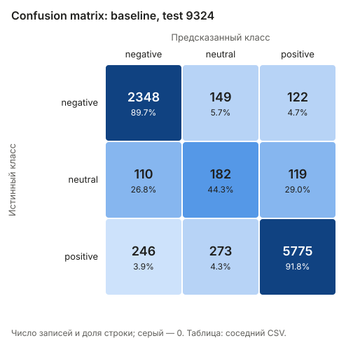
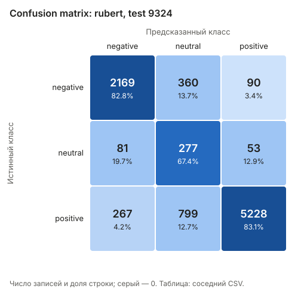

# T13: финальное сравнение на текстовом test

- Commit оценщика: `2b6f7d2d633844d6640ab068576457f08a226038`; основа T12: `5f22d93a8cff63b30fc129bb68a1cfbd4230995d`
- Фиксация: `reports/freeze.json` (`318712255d2b7074d1e03a75f6a2d2792cc61bcc119d9ff74313128149b452cd`), протокол t12/1
- Test: 9324 строк, Parquet `5854f134883efdfa45987602c0e90b8f777fea7af4ec93b5d566875fa1e14ab1`
- Команда: `python -m src.evaluate --run-final --freeze reports/freeze.json --out-dir reports/evaluation`
- Модель бота выбрана в T12 по validation: baseline; результат test её не меняет

| Модель | Accuracy | Macro-F1 | F1 negative | F1 neutral | F1 positive | Ошибок | мс/текст |
|---|---:|---:|---:|---:|---:|---:|---:|
| baseline | 0.8907 | 0.7264 | 0.8822 | 0.3586 | 0.9383 | 1019 | 0.055 |
| rubert | 0.8230 | 0.6803 | 0.8446 | 0.2999 | 0.8964 | 1650 | 1.382 |

## Confusion matrix: baseline

| истина \ ответ | negative | neutral | positive |
|---|---:|---:|---:|
| negative | 2348 | 149 | 122 |
| neutral | 110 | 182 | 119 |
| positive | 246 | 273 | 5775 |

## Confusion matrix: rubert

| истина \ ответ | negative | neutral | positive |
|---|---:|---:|---:|
| negative | 2169 | 360 | 90 |
| neutral | 81 | 277 | 53 |
| positive | 267 | 799 | 5228 |
