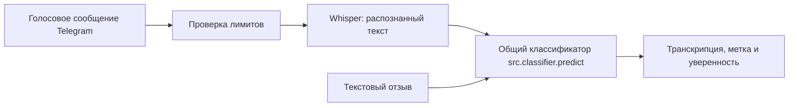

# Анализ тональности голосовых киноотзывов — итоговый отчёт

**Задача T17, [№19](https://github.com/ksdergach/ru-review-sentiment-bot/issues/19).**
Редакция от 22.11.2026 собрана по принятым результатам T12–T16. В неё вошли финальное
текстовое сравнение T13, голосовая оценка T14, анализ ошибок T15 и независимая проверка бота T16.
При подготовке T17 модели не обучались и не запускались, распознавание
не выполнялось, новые измерения не проводились. Все числа взяты из файлов
результатов, перечисленных в [разделе 12](#12-источники-воспроизведение-и-артефакты).
Сверка записана в [preparation_checks.json](preparation_checks.json).

**Командная вычитка этого документа ещё не проведена** (см. [раздел 13](#13-статус-t17)).
Промежуточный [отчёт NLP](../nlp/report.md) сохранён отдельно как материал предыдущего этапа.

## Кратко

| Вопрос | Ответ по принятым результатам |
|---|---|
| Даёт ли RuBERT преимущество перед TF-IDF + Logistic Regression? | **Нет.** На общем test из 9 324 записей baseline лучше по accuracy (0,8907 против 0,8230), macro-F1 (0,7264 против 0,6803) и F1 каждого класса. RuBERT медленнее примерно в 25 раз в расчёте на текст. Статистическая значимость разницы не проверялась |
| Насколько ошибки распознавания меняют классификацию? | На 36 голосовых записях macro-F1 baseline снизилась с 0,8299 (эталонная транскрипция) до 0,7019 (Whisper): ΔF1 = −0,1280. Корпусный WER — 0,1569. Пустых ответов и сбоев нет. Ответ изменился у 5 записей из 36, и все они относятся к истинному классу neutral. Выборка мала, поэтому оценки неустойчивы |

Самое слабое место системы — класс neutral. На test F1 neutral равна 0,3586 у baseline
и 0,2999 у RuBERT. В голосовой оценке всё снижение качества тоже пришлось на этот класс.

## 1. Цель и исследовательские вопросы

Система принимает русскоязычный голосовой киноотзыв в Telegram, распознаёт его
Whisper и классифицирует содержание текста. Результат — транскрипция, тональность
и оценка уверенности. Обычный текстовый ввод служит дополнительным режимом.
Область обучения и основной проверки — киноотзывы. Работа на любых сообщениях
Telegram в проекте не проверялась.

По [плану проекта](../../docs/team_plan.md), раздел 2, исследуются два вопроса:

| Вопрос | Эксперимент |
|---|---|
| Даёт ли RuBERT преимущество перед простым baseline? | Обучение на одном train, выбор параметров по validation, сравнение на одном неизменном test (T13) |
| Насколько ошибки распознавания речи меняют классификацию? | Одна модель классифицирует эталонную транскрипцию и результат Whisper для каждой из 36 записей (T14) |

Корректно измеренное отсутствие преимущества RuBERT план проекта прямо признаёт результатом.

Классы: `negative=0` — преобладает отрицательная оценка; `neutral=1` — выраженной
оценки нет либо оценки смешанные без явного перевеса; `positive=2` — преобладает
положительная оценка. Смешанный отзыв с ясным итогом относится к полярности итога.
Это правила проекта; исходные метки корпуса сохраняются без изменений.

## 2. Данные: происхождение, лицензия, структура

Источник — **Rustem Yeshpanov (2026), 100,000+ Movie Reviews from Kazakhstan:
Russian, Kazakh, and Code-Switched Texts**, отзывы с kino.kz. Использована
конфигурация `pc` репозитория `yeshpanovrustem/100k_movie_reviews_from_kz`, ревизия
`526df6aa3fdfc99cdbb2e2ce79406ae67816c1f9`. Заявленная лицензия — **CC BY 4.0**
(`license_declared: cc-by-4.0`). Доступ к данным отмечен как `gated: auto`.
Атрибуция, дата проверки доступа и суммы исходных файлов приведены в
[описании данных](../../NLP_dataset/README.md) и
[конфигурации источника](../../configs/dataset_source.json).
Полных исходных инструкций автора по разметке в аудите не было. Правила проекта
не выдаются за их дословное воспроизведение.

Три исходных Parquet побайтово совпали с закреплённой версией. Корпус содержит
100 502 записи, русскоязычная часть — 96 749. Поля: `movie_id`, `review_text`,
`review_sentiment`, `review_language`. Дат публикации и идентификаторов авторов
в схеме нет. Исходные файлы не изменялись: подготовка создаёт отдельные файлы.

## 3. Подготовка данных и независимость выборок

| Выборка после T03 | Всего | Negative | Neutral | Positive |
|---|---:|---:|---:|---:|
| Train | 76 971 | 21 482 | 3 290 | 52 199 |
| Validation | 10 396 | 2 825 | 436 | 7 135 |
| Test | 9 324 | 2 619 | 411 | 6 294 |

Всего после подготовки осталось 96 691 запись. Исключено 58 записей:
9 точных повторов и 49 близких. Нормализация текста применялась только для поиска
дубликатов и на вход классификатора не подаётся: Unicode NFC, регистр,
невидимые символы и пробелы. Близкие пары искались по символьным триграммам с порогом
Jaccard ≥ 0,9; по всем 59 кандидатам решения зафиксированы.
По принятому [аудиту T03](../data_prep/audit.json) между подготовленными выборками
нет общих фильмов (`movie_id`) и совпадающих нормализованных текстов. Это не доказывает
отсутствия любых смысловых совпадений. Семь пар близких копий внутри test сохранены;
T13 отдельно проверил чувствительность результата к ним (раздел 6).

В train 67,82 % записей — positive и только 4,27 % — neutral. Поэтому основная метрика —
macro-F1, где все три класса весят одинаково. Accuracy приводится вместе с метриками
по классам. Отсутствие null, пустых обязательных полей и недопустимых меток не означает,
что смысловая разметка безупречна.

Аудит T02 охватил 100 train-примеров, просмотренных агентом. 80 исходных меток
сочтены обоснованными, 15 случаев — неоднозначными, для пяти предложена другая метка.
Пользователь проверил 15 выбранных случаев; исходные метки не менялись.
Это не оценка частоты ошибок разметки во всём корпусе и не человеческая проверка всей сотни.
Источники: [аудит агента](../dataset/agent_review.md),
[ручная проверка](../dataset/manual_review.md), [агрегаты качества](../nlp/data_quality.json).

## 4. Архитектура и модели

Telegram-бот (`python -m src.bot`) — один процесс с polling, без сервера и базы данных.
Whisper выполняет распознавание речи (ASR), классификатор оценивает только содержание текста.
Интонация, тембр и акустические признаки эмоций не анализируются. Обучаемого класса
`noise` в основной версии нет. Уверенность — выход модели, а не подтверждённая
вероятность правильного ответа: калибровка не проверялась.

**Baseline.** TF-IDF по словам и биграммам: lowercase, min_df=2, max_df=0,98,
до 100 000 признаков, sublinear_tf, L2-нормировка. Словарь, IDF и веса классов
определяются только по train; отбор граничных признаков детерминирован.
Logistic Regression: lbfgs, max_iter=1000, tol=0,0001, seed=42.
C выбирался из 0,5 / 1 / 2 по validation macro-F1; выбран C=2.
Дополнительной ручной нормализации и усечения входа нет.
Конфиг: [nlp_baseline.json](../../configs/nlp_baseline.json).

**RuBERT.** `cointegrated/rubert-tiny2`, закреплённая revision
`e8ed3b0c8bbf4fb6984c3de043bf7d2f4e5969ae`, три выходных класса.
Одна полная эпоха на тех же 76 971 train ID: CPU, два потока, batch_size=64,
learning_rate=2e-5, weight_decay=0,01, веса классов по train, seed=42.
Тексты ограничены 64 токенами с усечением справа. Из двух контрольных точек
(шаги 602 и 1203) по validation macro-F1 выбран шаг 1203.
Конфиг и фактический запуск: [transformer.json](../../configs/transformer.json),
[run_metadata.json](../transformer/run_metadata.json).

**Whisper.** `Systran/faster-whisper-small`, revision
`536b0662742c02347bc0e980a01041f333bce120`: CPU, int8, восемь потоков,
language=ru, beam_size=5, VAD=true, temperature=0, condition_on_previous_text=true.
PyAV декодирует аудио в mono 16 kHz; отдельный FFmpeg CLI для штатного пути не нужен.
Whisper в проекте не дообучается. Конфиг: [speech.json](../../configs/speech.json).

## 5. Validation и выбор модели бота

| Модель | Accuracy | Macro-F1 | F1 negative | F1 neutral | F1 positive |
|---|---:|---:|---:|---:|---:|
| TF-IDF + Logistic Regression | 0,889381 | **0,718015** | 0,875110 | 0,338894 | 0,940040 |
| RuBERT-tiny2 | 0,818392 | 0,667824 | 0,835213 | 0,271713 | 0,896547 |

Обе строки относятся к одной validation из 10 396 ID. Precision, recall, support
и матрицы ошибок сохранены в [метриках baseline](../nlp/baseline_metrics.json)
и [отчёте RuBERT](../transformer/run_metadata.json). Разница macro-F1 (RuBERT минус
baseline) равна −0,050191. Validation участвовала в выборе C и контрольной точки, поэтому
это результат разработки, а не независимая финальная оценка.

В T12 координатор выбрал baseline для бота и для T14 по двум основаниям:
результат на validation и пригодность для Mac (Apple M1, восемь ядер, 16 GiB,
macOS 26.5.2 arm64, Python 3.13.7). Принятый комплект baseline имеет SHA-256
`389a768bcd108721c79ebf3a7b9dc5212ec100f5c2e1b06cf519ed076cd9bee3`.
Локально переобученные и исторические комплекты этим файлом не считаются.
Офлайн-проверка T12 подтвердила, что baseline и Whisper загружаются совместно:
пиковый RSS процесса — 898,3 MiB ([проверки T12](../freeze_checks.json)).
Это не оценка минимально необходимой памяти.

Все входы, модели, параметры и правила финальных оценок закреплены в
[фиксации T12](../freeze.json) (SHA-256 `318712255d2b7074d1e03a75f6a2d2792cc61bcc119d9ff74313128149b452cd`,
протокол `t12/1`, `status: approved`). Описание — в [протоколе](../freeze.md),
принятом в [PR №46](https://github.com/ksdergach/ru-review-sentiment-bot/pull/46).
Действует `post_test_policy`: после просмотра test обучение, веса, пороги, предобработка
и Whisper не меняются. Выбор модели бота после финальных результатов не пересматривался
(`bot_model_changed_by_test: false`).

## 6. Финальное сравнение на текстовом test (T13)

Источник — [final_metrics.json](../evaluation/final_metrics.json), сводка —
[final_report.md](../evaluation/final_report.md), методика — [README_T13](../../README_T13.md).
Запуск выполнен один раз 21.11.2026 командой
`python -m src.evaluate --run-final --freeze reports/freeze.json --out-dir reports/evaluation`
на commit оценщика `2b6f7d2d633844d6640ab068576457f08a226038`. Обе модели оценены
на одних и тех же 9 324 ID: Parquet `5854f134…fa1e14ab1`, `ids_sha256` `2128997f…bbfbbd73eb`.
Машина — Apple M1, 16 GiB, CPU, batch_size=64, два потока torch.

| Модель | Accuracy | Macro-F1 | F1 negative | F1 neutral | F1 positive | Ошибок |
|---|---:|---:|---:|---:|---:|---:|
| **TF-IDF + LR** (модель бота) | 0,8907 | **0,7264** | 0,8822 | 0,3586 | 0,9383 | 1 019 |
| RuBERT-tiny2 | 0,8230 | 0,6803 | 0,8446 | 0,2999 | 0,8964 | 1 650 |

| Класс (support) | Baseline P / R / F1 | RuBERT P / R / F1 | Ответов baseline / RuBERT |
|---|---|---|---:|
| negative (2 619) | 0,8683 / 0,8965 / 0,8822 | 0,8617 / 0,8282 / 0,8446 | 2 704 / 2 517 |
| neutral (411) | 0,3013 / 0,4428 / 0,3586 | 0,1929 / 0,6740 / 0,2999 | 604 / 1 436 |
| positive (6 294) | 0,9599 / 0,9175 / 0,9383 | 0,9734 / 0,8306 / 0,8964 | 6 016 / 5 371 |

Матрицы ошибок (строки — эталон, столбцы — предсказание; также
[CSV/SVG baseline](../evaluation/confusion_matrix_baseline.csv) и
[CSV/SVG RuBERT](../evaluation/confusion_matrix_rubert.csv)):

| Baseline | negative | neutral | positive | | RuBERT | negative | neutral | positive |
|---|---:|---:|---:|---|---|---:|---:|---:|
| negative | 2 348 | 149 | 122 | | negative | 2 169 | 360 | 90 |
| neutral | 110 | 182 | 119 | | neutral | 81 | 277 | 53 |
| positive | 246 | 273 | 5 775 | | positive | 267 | 799 | 5 228 |

- Baseline лучше RuBERT по accuracy, macro-F1 и F1 каждого класса. Соотношение
  совпадает с validation.
- RuBERT выдаёт neutral 1 436 раз при 411 нейтральных записях: recall этого класса у него выше
  (0,674 против 0,443), а precision намного ниже (0,193 против 0,301).
- Усечение RuBERT до 64 токенов затронуло 3 152 записи (33,8 %); у baseline усечения нет.
  Влияние усечения на качество не измерялось.
- **Чувствительность к повторам.** В test 7 групп близких повторов (14 записей). Если оставить
  первую запись каждой группы (9 317 записей), macro-F1 меняется на +0,00006 у baseline
  и на +0,00013 у RuBERT. Основным результатом остаётся полный test.
- Статистический тест значимости разницы не проводился. Test не использовался для подбора моделей.

**Время инференса** (один прогон, `time.perf_counter`):

| Модель | Загрузка, с | Прогрев, с | Инференс 9 324 текстов, с | мс/текст | Текстов/с |
|---|---:|---:|---:|---:|---:|
| Baseline | 0,474 | 0,006 | 0,515 | 0,055 | 18 102 |
| RuBERT | 1,879 | 0,021 | 12,889 | 1,382 | 723 |

Время партии — это не задержка ответа в Telegram. По протоколу исполнителя перед
запуском в фоне работал сторонний процесс, а непрерывного мониторинга нагрузки не было
([README_T13](../../README_T13.md#время)). Поэтому абсолютные значения ориентировочные.
На метрики качества фоновая нагрузка не влияет.

## 7. Голосовая оценка: эталон против Whisper (T14)

Голосовой набор T11 — 36 реальных записей OGG/Opus: четыре диктора по девять записей,
по 12 на каждый класс. Два разметчика независимо оценили эталонные тексты; разногласий
и отмеченной неоднозначности нет. Пять записей содержат бытовой шум, в трёх есть предупреждения
о клиппинге. Длительность записей — от 8,084 до 15,534 с, суммарно 431,817 с. Люди читали
подготовленные сценарии: это человеческий голос, но не спонтанная речь. Сведения о составе
и подтверждения: [composition.json](../voice_test/composition.json),
[human_confirmation.json](../voice_test/human_confirmation.json),
[процедура T11](../../README_T11.md). Аудио, таблица T11 и расшифровки хранятся вне Git.

Источник — [metrics.json](../voice_eval/metrics.json), сводка — [report.md](../voice_eval/report.md),
методика — [README_T14](../../README_T14.md). Запуск выполнен один раз командой
`python tools/evaluate_voice.py --warmup-audio <запись T16>` на commit
`a0e7a10e8e962bbb2bb2b437b9693c93234c96e9` из ветки PR #45; в `master` результат вошёл
коммитом `b005df8`. Классификатор — принятый baseline, `batch_size=1`.
Все 36 записей остаются в оценке. Пустой ответ ASR или сбой получил бы служебное предсказание −1;
таких случаев не было.

| Режим | Macro-F1 | Accuracy | Верно | Неверный класс | Нет предсказания |
|---|---:|---:|---:|---:|---:|
| Эталонная транскрипция | 0,8299 | 0,8333 | 30 | 6 | 0 |
| После Whisper | 0,7019 | 0,7222 | 26 | 10 | 0 |

**ΔF1 = F1_ASR − F1_эталон = −0,1280.**

| Класс (support 12) | P / R / F1 эталон | P / R / F1 Whisper |
|---|---|---|
| negative | 0,8182 / 0,7500 / 0,7826 | 0,7500 / 0,7500 / 0,7500 |
| neutral | 0,9000 / 0,7500 / 0,8182 | 0,8333 / 0,4167 / 0,5556 |
| positive | 0,8000 / 1,0000 / 0,8889 | 0,6667 / 1,0000 / 0,8000 |

Матрицы ошибок (строки — эталонный класс; столбец `error` пуст в обоих режимах):

| | Эталон: neg / neu / pos | Whisper: neg / neu / pos |
|---|---|---|
| negative | 9 / 1 / 2 | 9 / 1 / 2 |
| neutral | 2 / 9 / 1 | 3 / 5 / 4 |
| positive | 0 / 0 / 12 | 0 / 0 / 12 |

**Распознавание.** Корпусный WER = (ΣS + ΣD + ΣI) / ΣN = (106 + 13 + 7) / 803 = **0,1569**.
Нормализация `t12/1`: NFC → casefold → Unicode-пунктуация заменяется пробелами →
разделение по пробельным символам. Буквы «ё» и «е» различаются, цифры в слова не превращаются.
Нормализация для WER не меняет вход классификатора. Whisper: 36 успешных
распознаваний, пустых ответов 0, технических сбоев 0. Ошибок классификатора нет
ни на эталоне, ни на тексте Whisper.

**Время** (локально, Apple M1, Whisper на CPU int8, 8 потоков):

| Этап | n | Всего, с | Среднее, с | Медиана, с | p95, с |
|---|---:|---:|---:|---:|---:|
| Распознавание (`asr_seconds`) | 36 | 153,272 | 4,258 | 4,002 | 6,542 |
| Классификация эталона | 36 | 0,049 | 0,001 | 0,001 | 0,002 |
| Классификация текста Whisper | 36 | 0,077 | 0,002 | 0,001 | 0,004 |
| Распознавание + классификация (`total_seconds`) | 36 | 153,354 | 4,260 | 4,004 | 6,549 |

Загрузка и прогрев вне основного прохода: классификатор 0,310 + 0,005 с, Whisper 0,800 + 3,341 с.
По протоколу исполнителя во время запуска на машине была заметная фоновая нагрузка
(load average 2,98–29,62), поэтому значения времени могут быть завышены
([README_T14](../../README_T14.md#условия-измерения-времени)). Сетевая задержка Telegram
не измерялась.

Публичный построчный `predictions.csv` T14 содержит только ID, статусы и время,
без предсказаний. Предсказания убраны по решению координатора (вариант В1), чтобы
вместе с матрицами нельзя было восстановить эталонные метки отдельных записей
([README_T14](../../README_T14.md#конфиденциальность-публичных-результатов)).
Первоначальная версия файла остаётся в истории PR #45.

## 8. Анализ ошибок (T15)

Источник — [отчёт T15](../error_analysis/report.md) и его публичные файлы.
T15 не запускал модели и распознавание: использованы только результаты T13 и T14.

### 8.1. Текст: ошибки baseline на test

Ошибок — 1 019 из 9 324 (10,93 %). По направлениям:
positive → neutral 273, positive → negative 246, negative → neutral 149,
negative → positive 122, neutral → positive 119, neutral → negative 110
([text_summary.json](../error_analysis/text_summary.json)). Класс neutral участвует
в 651 ошибке из 1 019 (63,9 %), хотя составляет 4,4 % test.

Разобраны 40 ошибок. Правило отбора не зависит от содержания текстов: поочерёдный
обход шести направлений, внутри направления — порядок SHA-256 с seed 42.
Выборка равномерна по направлениям и **не пропорциональна** частотам ошибок,
поэтому доли категорий описывают только её. Категории могут пересекаться:

| Категория | Случаев из 40 |
|---|---:|
| `mixed` — смешанная оценка | 21 |
| `context` — оценка не фильма или текст не отзыв | 16 |
| `unclear_label` — спорная исходная метка (не изменялась) | 11 |
| `neutral_confusion` — размытая граница с neutral | 10 |
| `negation` — решающая оценка выражена отрицанием | 7, из них 1 оспорен проверкой |
| `sarcasm`, `short` | по 3 |
| `unknown` | 1 |

У 26 из 40 случаев есть хотя бы одна из категорий `mixed`, `neutral_confusion`
или `unclear_label`. Значит, заметная часть ошибок связана с размытой границей
классов и спорной разметкой, а не только со слабостью модели. Истинный neutral
неоднороден: в нём есть и смешанные отзывы без полярного итога, и тексты без оценки фильма.

**Ограничения разметки T15.** Черновик категорий и объяснений подготовил ИИ-ассистент;
метки и ответы модели при этом были видны. Участник команды проверил все 40 случаев
и согласился с 31, частично — с 9, не согласился — с 0
([human_review_evidence.json](../error_analysis/human_review_evidence.json)).
Это проверка одним участником, не слепая и не независимая разметка второго эксперта.
Девять частичных согласий уточняют формулировки причин. Для одного случая категория
`negation` оспорена проверкой и не считается установленной причиной ошибки; разметка
по решению координатора не изменялась. **Причинная связь категорий с ответом модели
не проверялась:** веса признаков и вклад слов не измерялись, объяснения являются гипотезами.

### 8.2. Голос: переходы «эталон → Whisper»

Используются только утверждённые публичные агрегаты
[voice_transitions.json](../error_analysis/voice_transitions.json). Они согласованы
с `metrics.json` T14 (SHA-256 `cac6208a…add852a7a`).

| Переход | Записей |
|---|---:|
| Верно в обоих режимах | 26 |
| Ухудшение: верно на эталоне, неверно после Whisper | 4 |
| Улучшение: неверно на эталоне, верно после Whisper | 0 |
| Неверно в обоих режимах, тот же ответ | 5 |
| Неверно в обоих режимах, ответ сменился | 1 |
| **Всего** | **36** |

Ответ изменился у 5 записей из 36. Все пять смен и все четыре ухудшения относятся
к истинному классу neutral; ответы для negative и positive не изменились ни разу.
Направления смены: neutral → negative — 2, neutral → positive — 2, negative → positive — 1.
Единого сдвига в одну полярность нет. Пустых распознаваний и технических сбоев нет.

**Ошибки слов и смена класса — разные явления.** WER показывает, что ошибки слов
частые (примерно каждое шестое слово эталона), а смена класса редкая (5 из 36).
**Корпусный WER не доказывает причину смены конкретного предсказания.** Какие отличия
распознанного текста повлияли на ответ, не установлено. Возможное объяснение — класс neutral
у baseline опирается на слабые сигналы. Это гипотеза, она не проверялась причинным экспериментом.
WER по группам записей, построчные переходы и транскрипции намеренно не публикуются:
вместе с ранее опубликованными данными они раскрывали бы результаты отдельных записей
([отчёт T15, Б.6](../error_analysis/report.md#б6-конфиденциальность-и-состав-публичных-агрегатов)).

## 9. Проверка бота (T16) и его ограничения

Независимая проверка на Mac 19.11.2026 описана в [протоколе T16](../bot/t16_independent_check_macos_2026-11-19.md).
Проверялся код `1c7486130d63f7cb7b4b1037a7cfdcd29b8afae7`; классификатор — **RuBERT**
(`CLASSIFIER_BACKEND=rubert`). Принятый baseline на тот момент на машине отсутствовал.
Подтверждены `/start`, текстовые ответы, распознавание голоса, совпадение метки голосового
ответа и той же расшифровки, отправленной текстом, отказы по длине текста (больше 2 000 символов)
и голоса (41 с), сообщение о занятости. Полный запуск тестов: **825 passed, 1 skipped,
43 warnings**. Пропущен тест принятого baseline, так как его комплекта не было.
Первоначальные отказы тестовых HTTP-серверов были вызваны ограничениями среды; после
разрешения локальных портов прогон прошёл без изменения кода.

**Это проверка сценариев с RuBERT, а не ручной Telegram-прогон выбранного baseline**
и не измерение качества на независимом потоке. Загрузка принятого baseline
проверена отдельно: офлайн-процесс T12 загрузил принятый baseline вместе с Whisper
без распознавания аудио и без Telegram ([протокол T12](../freeze.md)). Backend бота по умолчанию — baseline.
Ручной сквозной Telegram-прогон именно с принятым baseline и Whisper в рамках T16 и T17
не выполнялся.

На трёх специально составленных сложных текстах RuBERT в T16 ошибся с высокой
уверенностью. Сарказм с формальной похвалой получил positive; несогласие с негативной
оценкой и пересказ чужой критики при собственном положительном мнении получили negative.
Это иллюстрация ограничений, а не оценка точности; baseline на этих текстах не проверялся.
Дальнейшее исследование вынесено в необязательную [№44](https://github.com/ksdergach/ru-review-sentiment-bot/issues/44).

Ограничения реализации бота: голос ≤ 30 с и ≤ 5 MiB, текст ≤ 2 000 символов, один
занятый слот на процесс без очереди. Если ответ не готов за 60 с, отправляется одно уведомление
о задержке, а поздний результат не отправляется. Пустая речь и технические ошибки
не получают тональности. Аудио удаляется после обработки, а транскрипции не пишутся
в журналы. Подробности — в [README](../../README.md#ограничения-и-сообщения).
Не все граничные случаи проверялись вручную в T16.

## 10. Ответы на исследовательские вопросы

**1. Даёт ли RuBERT преимущество перед TF-IDF + Logistic Regression?**
Нет. На одном неизменном test из 9 324 записей baseline лучше дообученного RuBERT-tiny2
по всем основным метрикам: macro-F1 0,7264 против 0,6803 (−0,0461 у RuBERT),
accuracy 0,8907 против 0,8230. F1 каждого класса также выше у baseline. Тот же порядок
был на validation (0,7180 против 0,6678). RuBERT к тому же примерно в 25 раз медленнее
на текст на CPU. Вывод относится к этой конфигурации RuBERT (rubert-tiny2, одна эпоха,
64 токена, CPU) и данному корпусу киноотзывов. Значимость разницы не проверялась.
Другие архитектуры, длины контекста и режимы обучения не исследовались.

**2. Насколько ошибки распознавания меняют классификацию?**
На 36 записях T11 замена эталонной транскрипции результатом Whisper снизила macro-F1
baseline на 0,128 (0,830 → 0,702), а число верных ответов — с 30 до 26 при корпусном
WER 0,157. Сбоев и пустых ответов не было. Ответ изменился у 5 записей; все они относятся
к истинному классу neutral, где recall снизился с 0,75 до 0,42. Для negative и positive
ответы не изменились. При 12 записях на класс и четырёх дикторах оценки неустойчивы:
одна запись меняет accuracy на 2,8 п. п. Результат не переносится на спонтанную речь,
других дикторов и другие темы. Причина каждой смены по WER не устанавливается.

## 11. Ограничения исследования

- **Дисбаланс neutral.** В train 4,27 % neutral, в test — 4,4 %. F1 neutral на test — 0,3586
  у baseline и 0,2999 у RuBERT; это худший класс у обеих моделей.
- **Разметка.** Исходные метки не исправлялись, а часть ошибок связана со спорными метками.
  Полных инструкций аннотирования источника нет.
- **Домен.** Только киноотзывы с одного сайта. Произвольные сообщения Telegram и другие темы
  не проверялись.
- **Малый голосовой набор.** 36 записей, четыре диктора, чтение подготовленных сценариев,
  пять записей с бытовым шумом. Агрегаты не доказывают универсального эффекта Whisper.
- **Интонация не анализировалась**: классифицируется только текст. Калибровка уверенности
  не проверялась.
- **Статистика.** Тесты значимости и доверительные интервалы не рассчитывались.
  Каждая оценка получена одним прогоном.
- **Время.** Измерения локальные, на одной машине и под фоновой нагрузкой; задержка Telegram
  не измерялась.
- **Анализ ошибок T15** — интерпретация текста одним проверяющим без слепой разметки.
  Причинность не проверялась, выборка равномерна по направлениям, одна категория оспорена.
- **Проверка бота T16** выполнена с RuBERT, а не с выбранным baseline.
- **Дополнительные эксперименты** (#21–23, #44) в текущий цикл не входили и не заявлены выполненными.

## 12. Источники, воспроизведение и артефакты

Команды установки, получения данных и моделей, проверок и запуска бота приведены в
[README](../../README.md#маршрут-воспроизведения-и-итоговые-результаты).
Финальные оценки повторять не требуется: результаты закреплены суммами и проверяются
без моделей командами из таблицы ниже.

| Результат | Файлы в Git | Проверка без моделей |
|---|---|---|
| Данные T03 | [audit.json](../data_prep/audit.json), `reports/data_prep/split_ids.csv`, [dataset_source.json](../../configs/dataset_source.json) | — |
| Фиксация T12 | [freeze.json](../freeze.json), [freeze.md](../freeze.md), [freeze_checks.json](../freeze_checks.json) | SHA-256 `freeze.json` совпадает со значением в разделе 5 и в `run.freeze_sha256` отчётов T13/T14 |
| T13 | [reports/evaluation/](../evaluation/final_report.md): `final_metrics.json`, `final_table.csv`, `predictions.csv`, матрицы CSV/SVG | Пересчёт метрик по `predictions.csv`; суммы `outputs_sha256`; `python -m pytest -q tests/test_evaluate.py` (синтетические данные) |
| T14 | [reports/voice_eval/](../voice_eval/report.md): `metrics.json`, `report.md`, `predictions.csv` (без предсказаний) | `python -m pytest -q tests/test_evaluate_voice.py tests/test_voice_eval_public_results.py` |
| T15 | [reports/error_analysis/](../error_analysis/report.md) | `python tools/analyze_errors_t15.py --check`; `python -m pytest -q tests/test_analyze_errors_t15.py` |
| T16 | [протокол](../bot/t16_independent_check_macos_2026-11-19.md) | — |

Контрольные суммы ключевых файлов перечислены в [preparation_checks.json](preparation_checks.json).
Суммы выходных файлов T13 записаны в `final_metrics.json: outputs_sha256`.

В Git хранятся код, конфиги, суммы, ID без текстов и агрегаты. Вне Git остаются аудио,
таблица и manifest T11, построчные результаты T14 (`artifacts/t14/`), закрытые агрегаты
T15 (`artifacts/t15/`), модели, токены и выгрузки текстов. Полный повтор T13 и T14
возможен только на машине измерений с принятыми комплектами и приватными файлами T11,
по отдельному решению ([README_T13](../../README_T13.md#команды),
[README_T14](../../README_T14.md#подготовка-и-запуск)).

## 13. Статус T17

- Финальные результаты T13, T14, T15 и проверка T16 приняты и включены в отчёт; задачи #14, #16, #17
  и #18 закрыты.
- Числа отчёта сверены с исходными JSON/CSV автоматически; подробности — в
  [preparation_checks.json](preparation_checks.json).
- **Командная вычитка не проведена.** Отчёт не считается окончательно принятым,
  пока участник команды не подтвердит вычитку.
- Ручной Telegram-прогон выбранного baseline не выполнялся (раздел 9); это зафиксированное
  ограничение, а не скрытый результат.
