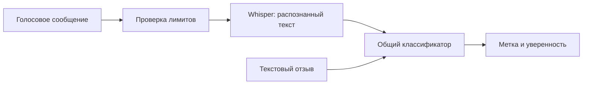

# Анализ тональности голосовых киноотзывов — черновик итогового отчёта

**Статус: подготовительная часть T17, задача [№19](https://github.com/ksdergach/ru-review-sentiment-bot/issues/19).**
Финальные текстовые/голосовые метрики и анализ ошибок T15 пока не получены.
Этот документ не является завершённой сдачей; поля «ожидается» обозначают отсутствие
измерения, а не ноль. Промежуточный [отчёт NLP](../nlp/report.md) сохранён отдельно.

Основа этой редакции — master `c663bf5b627f5b6c5b081b9d7c541269e1fc57b8`.
Протокол T12 утверждён координатором и принят:
[PR №46](https://github.com/ksdergach/ru-review-sentiment-bot/pull/46) слит 20.11.2026,
задача №15 закрыта. Проверенный HEAD PR — `fc6c55e05f35fd9d67cad26aca32c6fd32327738`.
[Фиксация в принятой версии](https://github.com/ksdergach/ru-review-sentiment-bot/blob/c663bf5b627f5b6c5b081b9d7c541269e1fc57b8/reports/freeze.json)
содержит идентификаторы входов, комплекты и параметры. Она не копируется и не
переопределяется этим отчётом. Исполнение финальных запусков согласуется отдельно.

В [повторном ревью](https://github.com/ksdergach/ru-review-sentiment-bot/pull/46#pullrequestreview-5987303991)
`rail-ss` подтвердил критерии C1–C4 и устранение двух дефектов восстановителя:
проверку результата по утверждённым суммам и атомарную публикацию файла.
Ревьюер воспроизвёл 18 синтетических тестов. Эта зависимость закрыта; T17 не меняет
принятую фиксацию и не выдаёт технические тесты за оценку качества моделей.

## Цель и исследовательские вопросы

Система принимает русскоязычный голосовой киноотзыв в Telegram, распознаёт его
Whisper и классифицирует содержание текста. Результат — транскрипция, тональность
и оценка уверенности. Обычный текстовый ввод служит дополнительным режимом.
Область обучения и основной проверки — киноотзывы; работу на любых сообщениях
Telegram проект не устанавливает.

По [плану проекта](../../docs/team_plan.md) исследуются два вопроса:

| Вопрос | Эксперимент | Доступный ответ |
|---|---|---|
| Даёт ли RuBERT преимущество перед TF-IDF + Logistic Regression? | Общие train/validation, затем одинаковый неизменный test | На validation преимущества нет; независимый ответ ожидает T13 |
| Насколько ошибки распознавания меняют классификацию? | Один классификатор на эталоне и результате Whisper для каждого из 36 ID | Ожидает T14; работа голосового интерфейса этого ответа не даёт |

Классы: `negative=0` — преобладающая отрицательная оценка; `neutral=1` — отсутствие
выраженной оценки или смешанные оценки без явного перевеса; `positive=2` —
преобладающая положительная оценка. Смешанный отзыв с ясным итогом относится к
полярности итога. Это правила проекта; исходные метки корпуса сохраняются.

## Данные, происхождение и подготовка

Источник — **Rustem Yeshpanov (2026), 100,000+ Movie Reviews from Kazakhstan:
Russian, Kazakh, and Code-Switched Texts**, отзывы с kino.kz. Использована
конфигурация `pc` репозитория `yeshpanovrustem/100k_movie_reviews_from_kz`, ревизия
`526df6aa3fdfc99cdbb2e2ce79406ae67816c1f9`. По сохранённой проверке источника
заявлена лицензия **CC BY 4.0**, доступ к данным отмечен `gated: auto`.
Атрибуция, дата проверки доступа и суммы исходных файлов находятся в
[описании данных](../../NLP_dataset/README.md) и
[конфигурации источника](../../configs/dataset_source.json).
Полные исходные инструкции автора по разметке в том аудите недоступны; правила
проекта не выдаются за их дословное воспроизведение.

Три исходных Parquet побайтово совпали с закреплённой версией. Корпус содержит
100 502 записи; русскоязычная часть — 96 749. Поля: `movie_id`, `review_text`,
`review_sentiment`, `review_language`. Дат публикации и идентификаторов авторов
в этой схеме нет. Исходники не изменялись; подготовка создаёт отдельные файлы.

| Выборка после T03 | Всего | Negative | Neutral | Positive |
|---|---:|---:|---:|---:|
| Train | 76 971 | 21 482 | 3 290 | 52 199 |
| Validation | 10 396 | 2 825 | 436 | 7 135 |
| Test | 9 324 | 2 619 | 411 | 6 294 |

Суммарно осталось 96 691 записей. Удалены 9 точных и 49 близких повторов.
Тексты нормализовались для поиска дубликатов, а не для подмены входа классификатора:
Unicode NFC, регистр, невидимые символы и пробелы; близкие пары искались по
символьным триграммам с Jaccard ≥ 0,9 и зафиксированным решениям проверки.
По принятому [аудиту T03](../data_prep/audit.json) пересечений фильмов и точных
нормализованных текстов между подготовленными сплитами нет. Это не доказывает
отсутствие любых смысловых совпадений. Семь пар близких копий внутри test сохранены;
T13 отдельно проверит чувствительность к одной копии каждого повтора.

В train 67,82% positive и 4,27% neutral. Основная метрика — macro-F1 с одинаковым
весом трёх классов; accuracy сопровождается классовыми метриками. Отсутствие null,
пустых обязательных полей и недопустимых меток не означает идеальной смысловой разметки.

Аудит T02 включал 100 train-примеров, просмотренных агентом: 80 исходных меток
сочтены обоснованными, 15 случаев неоднозначны, для пяти предложена другая метка.
Пользователь проверил 15 выбранных случаев; исходные метки не менялись.
Это не оценка частоты ошибок во всём корпусе и не человеческая проверка всей сотни.
Источники: [аудит агента](../dataset/agent_review.md),
[ручная проверка](../dataset/manual_review.md), [агрегаты качества](../nlp/data_quality.json).

## Архитектура и модели

Whisper выполняет ASR; классификатор оценивает содержание текста. Интонация,
тембр и эмоциональные акустические признаки не анализируются. Дополнительного
обучаемого класса `noise` в основной версии нет. Уверенность — выход модели,
а не подтверждённая вероятность правильного ответа.

**Baseline.** TF-IDF по словам и биграммам, lowercase, min_df=2, max_df=0,98,
до 100 000 признаков, sublinear_tf и L2-нормировка. Словарь/IDF и веса классов
определяются только по train; отбор граничных признаков детерминирован.
Logistic Regression: lbfgs, max_iter=1000, tol=0,0001, seed=42.
C выбирался из 0,5/1/2 по validation macro-F1; выбран C=2.
Дополнительной ручной нормализации или усечения входа нет.
Конфиг: [nlp_baseline.json](../../configs/nlp_baseline.json).

**RuBERT.** `cointegrated/rubert-tiny2`, закреплённая revision
`e8ed3b0c8bbf4fb6984c3de043bf7d2f4e5969ae`, три выходных класса.
Одна полная эпоха на тех же 76 971 train ID, CPU, два потока, batch_size=64,
learning_rate=2e-5, weight_decay=0,01, веса классов по train, seed=42.
Тексты ограничены 64 токенами с усечением справа. Из двух точек проверки
(шаги 602 и 1203) по validation macro-F1 выбран шаг 1203.
Конфиг и фактический запуск: [transformer.json](../../configs/transformer.json),
[run_metadata.json](../transformer/run_metadata.json).

**Whisper.** `Systran/faster-whisper-small`, revision
`536b0662742c02347bc0e980a01041f333bce120`: CPU int8, восемь потоков,
language=ru, beam_size=5, VAD=true, temperature=0, condition_on_previous_text=true.
PyAV декодирует в mono 16 kHz; отдельный FFmpeg CLI для штатного пути не обязателен.
Whisper в проекте не дообучается. Конфиг: [speech.json](../../configs/speech.json).

## Validation и выбор модели бота

| Модель | Accuracy | Macro-F1 | F1 negative | F1 neutral | F1 positive |
|---|---:|---:|---:|---:|---:|
| TF-IDF + Logistic Regression | 0,889381 | **0,718015** | 0,875110 | 0,338894 | 0,940040 |
| RuBERT-tiny2 | 0,818392 | 0,667824 | 0,835213 | 0,271713 | 0,896547 |

Обе строки относятся к одной validation из 10 396 ID. Precision, recall, support
и confusion matrix сохранены в [метриках baseline](../nlp/baseline_metrics.json)
и [отчёте RuBERT](../transformer/run_metadata.json). Разница macro-F1 RuBERT минус
baseline — −0,050191. Validation участвовала в выборе C/чекпоинта: это результат
разработки, не независимая финальная оценка и не доказательство превосходства
архитектуры baseline во всех условиях.

В T12 координатор выбрал baseline для бота и T14 по validation и пригодности
Mac: Apple M1, восемь ядер, 16 GiB, macOS 26.5.2 arm64, Python 3.13.7.
Принятый N02 bundle имеет SHA-256
`389a768bcd108721c79ebf3a7b9dc5212ec100f5c2e1b06cf519ed076cd9bee3`.
Локально переобученные и исторические комплекты не считаются этим же файлом.

Офлайн-проверка T12 подтвердила совместную загрузку baseline и Whisper:
пиковый RSS процесса — 898,3 MiB. ASR в этой проверке не декодировался;
это не сравнение скорости инференса и не оценка минимально необходимой памяти.
Версии среды, суммы и первичный прогон 16 целевых тестов находятся в
[проверках T12](../freeze_checks.json). Отдельные
[проверки доработки](../freeze_review_fix.json) фиксируют 18 тестов восстановителя
и `UNCHANGED` для существующего test при запрещённых декодировании и записи.
Эти прогоны выполнены на этапах T12; при подготовке T17 они не повторялись.
Выбор бота после просмотра test не пересматривается.

## Голосовой набор и протокол оценки

Принятый T11 — 36 реальных OGG/Opus-записей, четыре диктора по девять записей,
по 12 на каждый класс. Два разметчика независимо оценили содержание эталонов;
разногласий и отмеченной неоднозначности нет. Пять записей содержат бытовой шум.
Длительность 8,084–15,534 с, суммарно 431,817 с. Люди прочитали подготовленные
сценарии; это человеческий голос, но не спонтанная речь.

Прослушивание, сверка эталонов и независимость разметки подтверждены людьми
в [human_confirmation.json](../voice_test/human_confirmation.json).
[Состав и суммы](../voice_test/composition.json), [процедура T11](../../README_T11.md).
В T12 повторно совпали все аудиофайлы и таблица; валидатор вернул `UNCHANGED`.
Предупреждения о клиппинге в трёх записях сохранены, записи не исключены.

T14 применяет один baseline к ручной транскрипции и результату Whisper для
каждого ID. Все 36 записей остаются в оценке. Пустой ASR/сбой получает служебное
предсказание −1: он штрафует истинный класс, но не добавляет четвёртый класс
в среднее F1. Сбои и пустые ответы также считаются отдельно.

Корпусный WER — сумма пословных замен/удалений/вставок, делённая на общее число
слов эталонов. Нормализация: NFC → casefold → Unicode-пунктуация в пробелы →
разделение по пробельным символам; ё/е различаются, цифры не превращаются в слова.
При пустом ASR все слова эталона считаются удалёнными. WER-нормализация не меняет
вход классификатора. Загрузка, прогрев и основной проход измеряются отдельно;
локальное время ASR+classification не выдаётся за сетевую задержку Telegram.
Полные правила и суммы определяет T12, а не этот пересказ.

## Результаты финальных экспериментов — ожидаются

### T13: общий текстовый test, 9 324 ID

| Модель | Accuracy / macro-F1 | Классовые метрики / confusion matrix | Время / усечение |
|---|---|---|---|
| TF-IDF + Logistic Regression | Ожидается №16 | Ожидается №16 | Ожидается №16 |
| RuBERT-tiny2 | Ожидается №16 | Ожидается №16 | Ожидается №16 |

Нужны результаты на одинаковых ID, основном неизменном test и отдельная оценка
чувствительности к повторам. Версия оценщика, команда воспроизведения, файлы
предсказаний по ID и итоговые JSON/CSV/графики будут добавлены после принятого запуска.
Техническое восстановление test по T03 в T12 не запускало модели; само чтение
исходника для копирования строк раскрыто в протоколе фиксации.

### T14: эталон против ASR, все 36 ID

| Режим | Macro-F1 / accuracy / классы | Ошибки / время |
|---|---|---|
| Baseline на эталоне | Ожидается №17 | Ожидается №17 |
| Тот же baseline после Whisper | Ожидается №17 | Ожидается №17 |

ΔF1=(ASR − эталон), корпусный WER, число пустых ответов/сбоев и тайминги пока
**не измерены**. Результат отдельного отладочного аудио или удачного сообщения
в Telegram не подставляется в эту таблицу. После запуска нужны все 36 ID,
статусы, предсказания и агрегаты; расшифровки остаются приватными.

## Ручная проверка бота и известные ограничения

Принятая [проверка T16 на Mac](../bot/t16_independent_check_macos_2026-11-19.md)
использовала RuBERT и код `1c7486130d63f7cb7b4b1037a7cfdcd29b8afae7`.
Подтверждены `/start`, текстовые ответы, распознавание голоса, совпадение результата
для расшифровки, отправленной текстом, отказы по длительности/длине и занятость.
Это проверка сценариев, не измерение accuracy на независимом потоке.

Тот полный запуск тестов: **825 passed, 1 skipped, 43 warnings**. Первоначальные
отказы тестовых HTTP-серверов были вызваны ограничением среды; после разрешения
локальных портов прогон прошёл без изменения кода. Пропуск относился к отсутствовавшему
тогда принятому baseline. Он получен и проверен позже в T12, но реальный Telegram-прогон
с выбранным baseline этим не подтверждён. Новая репетиция относится к T18.

Лимиты приложения: голос ≤30 с и ≤5 MiB, текст ≤2 000 символов, один занятый слот
на процесс. Для второго отзыва предлагается повторить позже. Через 60 с ожидания
отправляется уведомление о задержке; рабочий поток завершается самостоятельно,
поздний ответ не отправляется. Пустая речь и технические ошибки не получают
тональность. Эти правила описывают реализацию; все граничные случаи не объявляются
вручную проверенными одним протоколом T16. Подробнее — [README](../../README.md).

На трёх искусственных сложных текстах в T16 RuBERT ошибся: сарказм принят за positive,
несогласие с критикой и цитирование чужой критики — за negative, с высокой уверенностью.
Это ограничения обработки смысла; причина «недообучение» не установлена.
Исследование вынесено в необязательную [№44](https://github.com/ksdergach/ru-review-sentiment-bot/issues/44).

## Анализ ошибок и выводы

Для принятого baseline ранее разобраны 40 ошибок **validation**. Пользователь
проверил объяснения: 30 согласий и 10 частичных согласий; он видел тексты,
метки, прогнозы и первоначальные объяснения агента. Это не слепая независимая
разметка. Среди наблюдений — короткие тексты, редкие написания, объект оценки,
ирония и близкие оценки классов. Источники: [анализ](../nlp/baseline_analysis.md),
[подтверждение проверки](../nlp/human_review_evidence.json).

**T15 ожидается:** после T13/T14 нужно воспроизводимо отобрать 30–50 ошибок
выбранной модели на test (или все, если меньше), сохранить ID/категории и проверить
объяснения человеком. Для голоса отдельно сопоставить ошибку на эталоне и после
Whisper, исправленные/добавленные ошибки, пустые ответы и сбои.
Выводы этого анализа не используются для изменения зафиксированных моделей.

На текущем этапе установлена работоспособность конвейера и отсутствие преимущества
RuBERT на validation. Нейтральный класс сложен для обеих моделей. Независимый ответ
на первый исследовательский вопрос требует T13; влияние ASR на качество остаётся
неизвестным до T14. Честно полученное отсутствие улучшения допустимо.

Ограничения: дисбаланс neutral, возможная неоднозначность исходной разметки,
малый голосовой набор и четыре диктора, чтение сценариев, кино-домен, отсутствие
анализа интонации и проверки калибровки уверенности. Дополнительные #21–23/#44
исключены из текущего цикла T12; расширения и новое обучение не заявляются выполненными.

## Воспроизведение и условия завершения T17

Маршрут установки, данных, принятых моделей, обучения в отдельной копии,
проверок и запуска — в [README](../../README.md#маршрут-воспроизведения-и-статус-финальной-оценки).
Отчёт опирается на сохранённые результаты; при подготовке T17 модели не запускались,
обучение и новые измерения не выполнялись. Проверки ссылок/чисел/сумм записаны в
[preparation_checks.json](preparation_checks.json).

Код, конфиги, суммы, ID и агрегаты хранятся в Git. Новые аудио, таблица T11,
приватный manifest, расшифровки, модели, токены и новые выгрузки текстов — вне Git.
Финальные результаты публикуются с версиями/командами и без подбора параметров по ним.

Для завершения №19 остаются:

- финальные артефакты №16/№17, сверка всех чисел с JSON/CSV;
- анализ №18 с реальной проверкой участником и ответы на оба исследовательских вопроса;
- команды финального воспроизведения из принятых реализаций, проверенные на выбранной машине;
- командная вычитка документа, удаление пометок ожидания только после появления результатов.

Критерии приёмки №19 полностью не закрыты. Подготовительный PR должен ссылаться
`Refs #19`; `Closes #19` допустим только после завершения зависимых работ.
